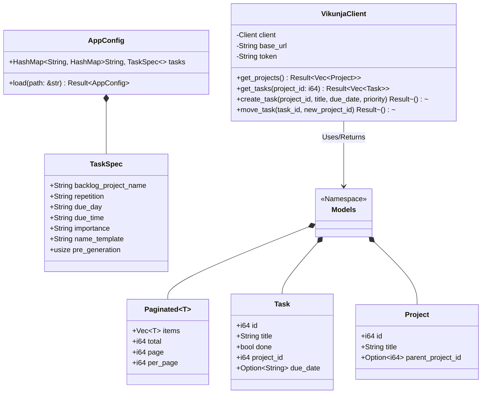
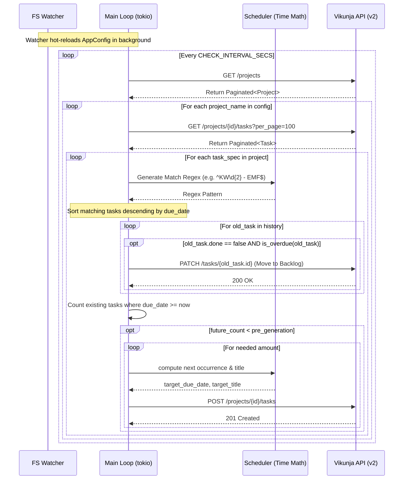

# 📚 Project Documentation: `vikunja-task-daemon`

## 1. Overview
The `vikunja-task-daemon` is a long-running, lightweight background service written in Rust. It automates the lifecycle of recurring tasks in Vikunja using the **Vikunja v2 API**. 

Instead of simple static recurrence, this tool enables:
* **Dynamic Title Injection:** (e.g., automatically appending the ISO week like `KW46`).
* **Intelligent Backlog Migration:** Automatically moving incomplete, overdue tasks into a dedicated "Backlog" project.
* **Pipeline Pre-generation:** Maintaining exactly $N$ future instances of a task in advance.
* **Hot-Reloading:** Instantly applying changes to the `config.yaml` without needing to restart the container.

---

## 2. System Architecture (UML)

The system is decoupled into discrete modules handling Configuration, API Communication, Date Scheduling/Math, and File Watching. 



---

## 3. Calling Flow & Execution Loop (Sequence Diagram)

The daemon runs an asynchronous loop bounded by `CHECK_INTERVAL_SECS`. Inside this loop, it orchestrates the reading of state from Vikunja, performing chronological math, migrating old tasks, and generating new ones.



---

## 4. Module Breakdown

| Module | File | Purpose |
| :--- | :--- | :--- |
| **Orchestrator** | `src/main.rs` | Initializes the async Tokio runtime, manages the state lock (`Arc<RwLock>`), and runs the master execution loop. |
| **Configuration** | `src/config.rs` | Parses the `config.yaml` file into Serde models, applying defaults (like `pre_generation: 1` and `backlog_project_name: "Backlog"`). |
| **Scheduler** | `src/scheduler.rs` | The chronological brain. Safely handles timezone bindings (`chrono-tz`), ISO week generation (`{calender_week}`), and calculates future `next_occurrence` loops safely bypassing daylight savings bugs. |
| **Watcher** | `src/watcher.rs` | Uses `notify-debouncer-mini` to monitor changes to the YAML file in real-time, validating updates before mutating the running configuration lock. |
| **Vikunja Client** | `src/vikunja/client.rs` | The Reqwest HTTP client tailored for the Vikunja **v2 API**. Handles `Paginated<T>` envelopes, `PATCH` requests for partial updates (JSON Merge Patch), and Auth bearers. |
| **Models** | `src/vikunja/models.rs` | Struct representations of Vikunja's internal datatypes mapped perfectly to their Snake-Case JSON equivalents. |

---

## 5. Deployment & Configuration

### 5.1 Environment Variables
| Variable | Description | Default |
| :--- | :--- | :--- |
| `VIKUNJA_API_URL` | **(Required)** Target instance URL | e.g., `https://tasks.example.com/api/v2` |
| `VIKUNJA_API_TOKEN` | **(Required)** Application Bearer Token | — |
| `TIMEZONE` | Evaluates 'today' dynamically | `UTC` (Recommend: `Europe/Berlin`) |
| `CHECK_INTERVAL_SECS`| Tick rate of the main sequence loop | `60` |
| `CONFIG_FILE_PATH` | Path inside container | `/etc/vikunja-daemon/config.yaml` |

### 5.2 Example `config.yaml`
```yaml
tasks:
  Operations:
    EMF:
      backlog_project_name: "Backlog"
      repetition: "1 week"
      due_day: "wednesday"
      due_time: "15:37"
      importance: "HIGH"
      name_template: "{calender_week} - EMF"
      pre_generation: 1
```

### 5.3 Quick-Start (`docker-compose.yml`)
```yaml
version: "3.8"

services:
  vikunja-daemon:
    image: vikunja-task-daemon:latest
    build: .
    restart: unless-stopped
    environment:
      - VIKUNJA_API_URL=https://tasks.yourdomain.com/api/v2
      - VIKUNJA_API_TOKEN=your_token_here
      - TIMEZONE=Europe/Berlin
    volumes:
      - ./config.yaml:/etc/vikunja-daemon/config.yaml:ro
```